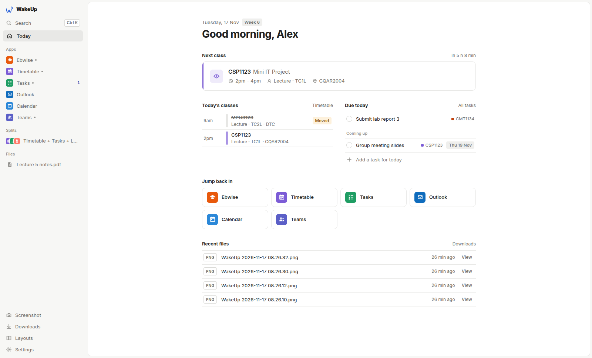
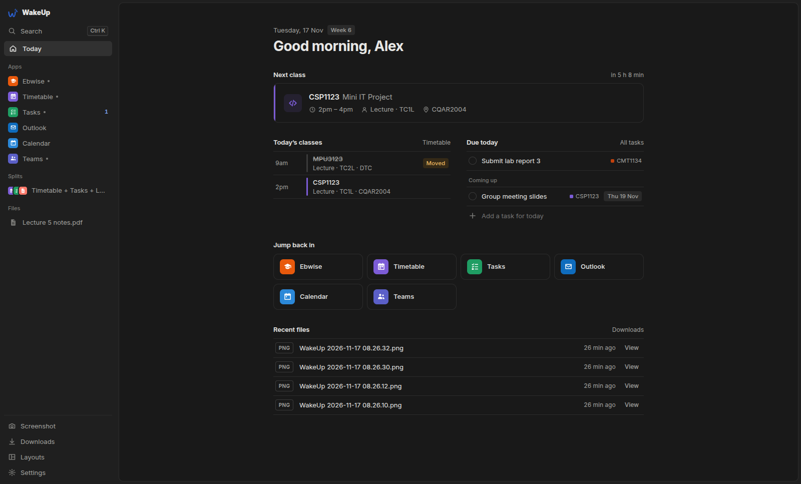
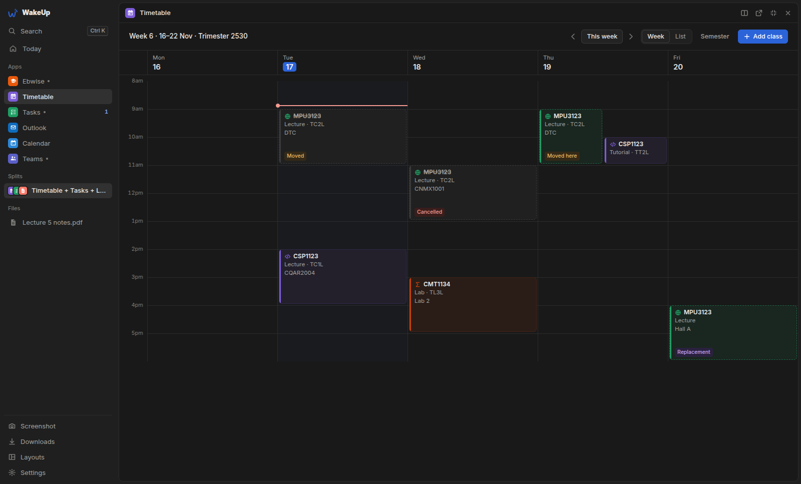
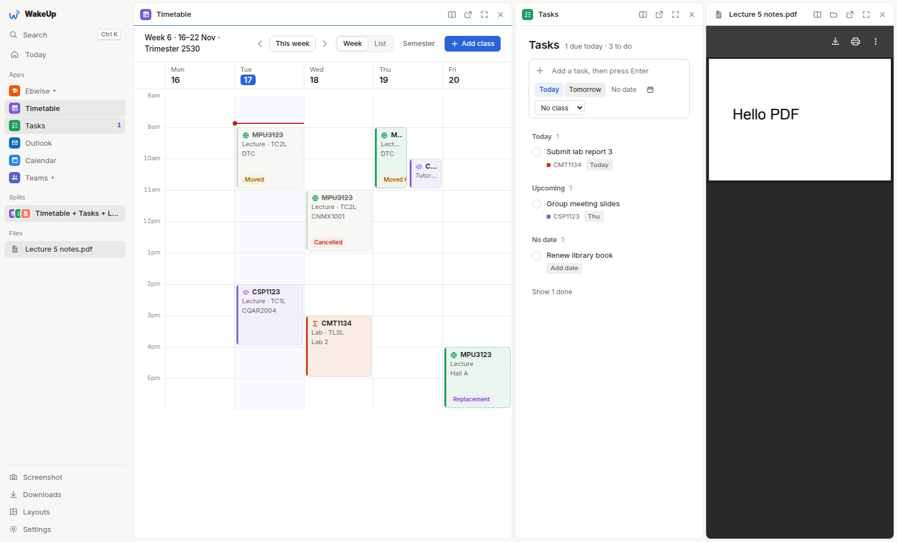

<p align="center">
  
</p>

<h1 align="center">WakeUp</h1>

<p align="center">
  One calm window for MMU student life: Ebwise, Outlook, Teams, your timetable and your to-dos.
</p>

<p align="center">
  
  
  
  
</p>



WakeUp is a lightweight desktop and Android app that keeps the web apps you use for class together in one window. You see one app at a time, or a few side by side when you need to. A built-in **Timetable** and **Tasks** list work offline. A **Today** screen shows your next class and what's due before you open anything else.

---

## Contents

- [Features](#features)
- [Screenshots](#screenshots)
- [Install](#install)
- [Using WakeUp](#using-wakeup)
- [Keyboard shortcuts](#keyboard-shortcuts)
- [Settings](#settings)
- [Privacy and your data](#privacy-and-your-data)
- [Performance](#performance)
- [Development](#development)
- [Troubleshooting](#troubleshooting)
- [Roadmap](#roadmap)
- [Credits and licence](#credits-and-licence)

## Features

| | |
|---|---|
| **One app at a time** | Click an app in the sidebar to show it on its own. Switching apps is instant, and apps you leave stay signed in. |
| **Splits when you want them** | Drag an app onto an open one, or use **Split with…** in its title bar, to view two or more side by side. WakeUp remembers each split, so clicking any app in it brings the whole split back. |
| **Pop out** | Any app, PDF or built-in view can move into its own window and dock back when you close it. |
| **Today** | A greeting, the semester week, your next class with a countdown and a **Join meeting** button, today's classes, tasks due, your apps and recent files. |
| **Timetable** | Add each class once (lecture, tutorial, lab, section, venue, or online with a meeting link) and it repeats every week for the semester, skipping breaks. You can mark a single date as cancelled, online or moved, or add a replacement class. Includes week and list views, line icons and colours, reminders before class, and import/export. |
| **Tasks** | A fast to-do list with due dates (Today, Tomorrow, or a date you pick), optional class links, Overdue/Today/Coming up/Someday groups, and a small celebration when you tick one off. |
| **PDFs inside WakeUp** | Ebwise course files and downloaded PDFs or images open beside the app you're in, full screen, or in their own window. They use Chromium's built-in viewer, so you keep zoom, search and print. |
| **Screenshots** | `Ctrl+Shift+S` captures everything on screen, web apps included. The camera in each app's title bar captures just that app, or lets you **select an area**: drag a box, move it or resize it from its edges, then press Enter. Screenshots are copied to the clipboard (on Wayland through `wl-copy` when it's installed) and can open beside your work. |
| **Downloads** | Files go straight to your Downloads folder and show progress in a panel. Duplicate names get `(1)`, `(2)`. Files that could run code are never opened automatically. |
| **Smart links** | `mailto:` links start an email in Outlook and Teams meeting links open in Teams. Other links go to your browser or a WakeUp window, whichever you choose. Right-click any link to copy it, save it, or pick where it opens. |
| **Ebwise stays signed in** | Ebwise forgets its own sign-in when the app closes; WakeUp signs you back in with your Microsoft 365 account automatically, and reopens any Ebwise PDF you had open. |
| **Jump to anything** | `Ctrl+K` searches apps, splits, files and actions. |
| **Always know what's happening** | Downloads, signing in, saving, screenshots and errors show as notices at the bottom of the sidebar, with progress and a next step (Retry, View, Show in folder). Each app's title bar says when it's loading, signing in, asleep, offline or stuck. |
| **A sidebar that fits** | Collapse it to icons with the button at its top, drag its edge to any width (double-click to reset), and it folds by itself on small windows. Splits keep every app usable as the window shrinks. |
| **Find in page** | `Ctrl+F` in any app, including popped-out windows. |
| **Your own apps and AI assistants** | Add any https website with its own sign-in or your Microsoft 365 one. Settings, Apps has one-click ChatGPT, Claude, Gemini, Copilot, Perplexity, DeepSeek, Grok and Le Chat. Each one you add keeps its own sign-in, so the same AI can be added twice for two accounts, and you can allow its microphone for voice chat. |
| **Easy on your laptop** | Apps you can't see go to sleep after a while and wake where you left off. Timetable and Tasks are drawn by WakeUp itself, so they cost no extra processes. |
| **Sync across your devices** | Sign in with Google (Settings → Account and sync) and your timetable, tasks and a few settings follow you between the laptop, your phone and your tablet. Edits made offline upload when you're back online. Signing in is optional; without it everything stays on the device. |
| **Android phone and tablet** | The same Today, Timetable, Tasks and apps on Android. Phones get a bottom bar (icons only on a Galaxy Z Flip cover screen); tablets get a rail in portrait and a labelled sidebar in landscape, and two apps can share the screen. |
| **Clean light and dark themes** | Neutral surfaces, thin borders and one blue accent; colour is kept for app icons, class colours and status tags. It follows your system, or you can pick one. |

## Screenshots

| Today (dark) | Timetable and Tasks, side by side |
|---|---|
|  |  |

| A PDF beside your apps |
|---|
|  |

*Screenshots come from a demo profile with made-up classes and tasks.*

## Install

**You need:** Linux (tested on Ubuntu with GNOME on Wayland), [Node.js](https://nodejs.org) 20 or newer, and Python 3 (for building the icons).

```bash
git clone https://github.com/kimzam30/WakeUp.git
cd WakeUp
npm ci
npm run dist
bash scripts/install.sh
```

`npm run dist` builds WakeUp into `dist/linux-unpacked`. The install script then:

1. installs it to `~/.local/lib/wakeup`, replacing any older version in one step;
2. adds the app icon and launcher;
3. keeps your dock pin, and restarts WakeUp if it was running.

Your sign-ins, timetable and tasks are kept.

**Open just one app:** right-click WakeUp in the dock and pick it (for example Ebwise). Nothing else loads.

### Updating

WakeUp checks GitHub for a new version when it starts and every few hours. When one is out, a notice appears at the bottom of the sidebar: click **Update now**, then **Restart now**. Settings → About → Updates has the same buttons and an **auto-check** switch. Every download is checked against the release's checksums, which must carry WakeUp's release signature, before anything is replaced, and the old version is kept aside until the next start, so a failed update changes nothing.

One-click updates work for WakeUp installed with `scripts/install.sh` or run as an AppImage. When running from source, pull the latest code and run `npm run dist && bash scripts/install.sh` again.

### Android

Download `WakeUp-<version>.apk` from the [latest release](https://github.com/kimzam30/WakeUp/releases/latest) on your phone or tablet and open it. Android asks once to allow installs from your browser or file manager. To build it yourself, see [Development](#development).

After that, WakeUp updates itself: when a new version is out, Today shows a banner. Tap **Update now** and Android's installer opens with one **Install** button (the first time, it asks you to allow installs from WakeUp). Settings → About has a **Check for updates** button.

## Using WakeUp

### Getting around

- **Sidebar:**
  - **Today** is at the top.
  - Your apps are next. The coral bar shows which one you're looking at, and badges count unread mail and tasks due.
  - Remembered **Splits** and open **Files** are below the apps.
  - The tools at the bottom are Jump to (`Ctrl+K`), Screenshot, Downloads, Layouts and Settings.
- **Click** an app to show it on its own. **Middle-click** to close it.
- **Drag** an app from the sidebar onto the screen:
  - drop it on an edge to split;
  - drop it in the middle of an app to swap them.
- **Title bar buttons:** Back, Forward, Reload, **Split with…**, Open in browser (globe), Pop out (two windows), Fill the window, Close.
- **Layouts** (sidebar) arranges the open apps in a preset grid, or switches to free-floating windows you can move and resize.

### Setting up your timetable

1. Open **Timetable**, then click **+ Class**.
2. Enter the code and name, and pick an icon and colour.
3. Add each weekly session: lecture, tutorial or lab, section (e.g. `TC1L`), day, time, and venue or meeting link.
4. Set the semester's first and last day and any breaks under **Semester** (the sliders icon). Week numbers skip the breaks.
5. Click a class to:
   - **Join** an online class;
   - mark **just this date** as *Cancelled*, *Online* or *Postponed / moved*;
   - **add a replacement class**.

Use **Export** to back up your timetable, or share it with classmates, who can **Import** it.

## Keyboard shortcuts

| Shortcut | Action |
|---|---|
| `Ctrl+K` | Jump to an app, file or action (`Ctrl+Shift+K` inside Outlook and Teams) |
| `Ctrl+1` … `Ctrl+9` | Open an app |
| `Ctrl+Shift+H` | Today |
| `Ctrl+F` | Find in page |
| `Ctrl+R` | Reload |
| `Ctrl+W` | Close the app |
| `Ctrl+Shift+S` | Screenshot everything on screen |
| `Ctrl+J` | Downloads |
| `Ctrl+M` | Fill the window with the app (inside a split) |
| `Ctrl+Tab` / `Ctrl+Shift+Tab` | Next / previous app in a split |
| `Ctrl+Shift+O` | Pop out / dock back |
| `Ctrl+Shift+L` | Next layout |
| `Ctrl+Shift+F` | Tiled ↔ free-floating |
| `Ctrl+,` | Settings |
| `Ctrl+/` | Shortcut sheet |
| `Esc` | Close the open panel, menu or dialog |

## Settings

Open with `Ctrl+,`, the sliders icon in the sidebar, or **Settings…** in the tray menu.

| Section | Setting | Default |
|---|---|---|
| General | Your nickname (used on Today and in reminders) | *empty* |
| | Start at login | off |
| | Start hidden in the tray | off |
| | At launch, open: whatever you had open, Today, or one app only | whatever you had open |
| | When you close the window: keep in tray / minimise / quit | keep in tray |
| Apps | Show, keep running, notifications and order for each app; add your own apps | Microsoft To Do hidden |
| Timetable | Reminder before each class: off / 5 / 10 / 15 minutes | 10 minutes |
| | Weeks start on Monday or Sunday | Monday |
| | Export / import timetable | |
| Performance | Sleep apps you can't see after: never / 5 / 10 / 30 / 60 minutes | 10 minutes |
| | Count time hidden in the tray | on |
| | One Outlook for Mail and Calendar (saves about 200 MB) | off |
| Downloads & screenshots | Download folder | `~/Downloads` |
| | Ask where to save each file | off |
| | Open files when they finish | off |
| | Notify when a download finishes | on |
| | Screenshot folder | `~/Pictures/Screenshots` |
| | Copy screenshots to the clipboard | on |
| Links & documents | Links to other websites: your browser or a WakeUp window | your browser |
| | Ebwise files: beside the app / full screen / own window / your browser | beside the app |
| Appearance | Theme: system / light / dark | system |
| | Page zoom | 100% |
| | Show app names in the sidebar | on |
| | Icons-only sidebar (small windows switch to it by themselves) | off |

## Privacy and your data

- **No telemetry.** WakeUp doesn't track you or report usage anywhere.
- **The full policy** is in [PRIVACY.md](PRIVACY.md) and in the apps under Settings → Privacy & Legal (both come from `src/ui/legal.js`; run `node scripts/legal.js` after editing it).
- **Sync is optional.** If you sign in with Google, your timetable (classes, one-off changes and the semester), your tasks and a few settings (theme, accent, Today layout, week start, nickname, reminders, class label style, task reminder time and your custom apps) are stored in a Supabase database, where row-level security keeps them readable by your account only. Window layouts, folders and sign-ins to your apps never leave the device. Signing out keeps the local copy. **Sign out everywhere** and **Delete my cloud data** are in Settings → Privacy & Legal.
- On the desktop the sync sign-in is stored in `~/.config/WakeUp/auth.bin`, encrypted with your system keyring when one is available (Settings warns you if it isn't). On Android it's in the Keystore-backed SecureStore.
- Settings, layout, timetable and tasks are in `~/.config/WakeUp/state.json`, with a backup copy at `state.json.bak`.
- Sign-ins are kept by Electron in separate session partitions:
  - Microsoft 365 apps share one;
  - Ebwise has its own;
  - each custom app can have its own.
- The download history doesn't store download links, because SharePoint and Outlook links can carry access tokens.
- Each app is sandboxed. It can only use the camera, microphone and screen sharing if it's Teams. Links with other schemes (`file:`, `smb:` and so on) are never handed to your system.
- **Back up:** copy `~/.config/WakeUp`, or use **Timetable → Export** for your classes and tasks.
- **Reset:** quit WakeUp and delete `~/.config/WakeUp/state.json`. This keeps your sign-ins; delete the whole folder to sign out of everything.

## Performance

Measured on the development laptop, with a fresh profile and only Ebwise open, median of 3 runs:

| | Window shown | First page loaded | Memory (PSS) | Processes |
|---|---|---|---|---|
| WakeUp 2.1 | 527 ms | 586 ms | 352 MB | 8 |
| WakeUp 2.2 | 552 ms | 615 ms | 351 MB | 8 |

Most of the memory belongs to the web apps themselves. To keep WakeUp light:

- only the apps on screen load at start;
- hidden apps sleep;
- Timetable, Tasks and Today are plain HTML inside the main window, so they add no processes.

## Development

```text
src/
  main.js            app lifecycle, windows and views, settings/timetable validation, downloads, links, screenshots
  preload.js         the small, typed bridge between the UI and main (window.hub)
  services.json      built-in apps
  ui/
    index.html       the main window
    ui.js            layout engine, navigation, sidebar, panes, screenshots
    common.js        icons and helpers shared with pop-out windows
    planner-core.js  timetable and task logic (also used by main for reminders)
    today.js         the Today screen
    timetable.js     Timetable view and editors
    tasks.js         Tasks view
    switcher.js      Ctrl+K and the shortcut sheet
    settings.js      Settings page and Downloads panel
    find.js          find-in-page bar
    pop.html/.js     pop-out windows
    ui.css           the theme (light and dark)
  updater.js         one-click updates from GitHub Releases (checksummed, keeps the old version aside)
  sync.js            cloud sync for the desktop (Google sign-in through Supabase, outbox, live updates)
  shared/            code used by both apps: planner schema, sync logic, cloud config
mobile/              the Android app (Expo / React Native, Expo Router); see mobile/AGENTS.md
supabase/            database migrations and setup notes for sync
test/                unit tests (npm test); test/e2e: the desktop app end to end (npm run e2e)
scripts/
  install.sh         build and install for the current user
  make-icons.py      renders the app icons
  bump-version.js    sets the version for both apps
.github/workflows/
  release.yml        publishes a GitHub Release (desktop + Android) when the version changes on main
```

```bash
npm start                                   # run from source
WAKEUP_PROFILE=/tmp/wakeup-test npm start   # run with a throwaway profile (your real sign-ins stay untouched)
npm run dist                                # unpacked build in dist/linux-unpacked
npm run dist:appimage                       # optional single-file AppImage
npm test                                    # unit tests: sync, updater, legal text (seconds)
npm run e2e                                 # the real app end to end on throwaway profiles: every settings section
                                            # and switch, timetable, tasks, layouts, tabs, restarts, safety (~3 min)
```

The Android app lives in `mobile/`:

```bash
cd mobile && npm ci
npx expo run:android                        # development build on a connected device
npx tsc --noEmit && npx expo lint           # typecheck and lint
node ../scripts/android-e2e.js <serial>     # read-only walk through every screen on a connected device
```

`mobile/android` is generated (`expo prebuild`) and not committed; native settings belong in `mobile/app.json`.

### Releasing

Both apps share one version, kept in `package.json`:

```bash
node scripts/bump-version.js 2.6.0   # sets it for the desktop and Android apps (Android versionCode 20600)
```

Commit and push to `main`, or merge `dev` into `main`. The **Release** workflow builds the desktop tarball, the AppImage and the APK, writes `SHA256SUMS`, signs it as `SHA256SUMS.sig`, and publishes a GitHub Release named after the version, with the commit subjects since the last release as notes. A push whose version already has a release builds nothing. Installed apps see the new version within a few hours.

Android only installs an update signed with the same key as the app already on the device, so every release is signed with WakeUp's own key (`mobile/plugins/release-signing.js`). GitHub gets it from repository secrets (listed at the top of `.github/workflows/release.yml`), and a release without it fails rather than shipping an APK that can't update anyone. For a local build that installs over a release:

```bash
. ~/.config/wakeup-signing/env && cd mobile/android && ./gradlew assembleRelease
```

Desktop updates must be signed too: the release job signs `SHA256SUMS` with an Ed25519 key from the `UPDATE_SIGNING_KEY` secret (its private half is `~/.config/wakeup-signing/update-ed25519.pem`; the public half is `SIGNING_KEY` in `src/shared/update-core.js`). The desktop app refuses an update whose signature is missing or wrong.

Keep a backup of `~/.config/wakeup-signing` somewhere safe: if a key is lost, installed copies can't be updated and have to be reinstalled.

After changing dependencies, run `node scripts/third-party.js` to refresh `THIRD_PARTY_NOTICES.md`.

Logs are written to `~/.config/WakeUp/logs/main.log` (Settings → About → Open log folder). Everything coming from disk or the UI is validated in `main.js` (`cleanSettings`, `cleanLayout`, `cleanPlanner`, `cleanFiles`), so a damaged file resets the bad values instead of crashing the app.

## Troubleshooting

| Problem | Fix |
|---|---|
| A sign-in window opens and closes, or an app keeps asking you to sign in | Finish signing in inside the small pop-up; it closes by itself. If it still loops, reload the app with `Ctrl+R`. |
| An app shows "isn't responding" or "stopped working" | Click **Reload**. You stay signed in. |
| An app is blank after a long time hidden | It went to sleep to save memory; click it and it reloads where you left off. Turn this off per app with **Keep running** in Settings → Apps. |
| Screen sharing in Teams asks which screen to share | That's the Wayland system picker; choose a screen or window there. |
| No reminders | Check Settings → Timetable, and that the Timetable switch under Settings → Apps → Notify is on. |
| The layout is in a strange state | Settings → About → **Reset layout**. Your timetable, tasks and sign-ins are kept. |

## Roadmap

Done in 2.5 to 2.10:

- A tablet layout that matches the desktop, with smoother motion and swipe gestures.
- Replacement and move autofill, tasks linked to classes, and a Pomodoro timer.
- Accent colours, a customizable Today page, app logos and your Google profile picture.
- Open the same app in a second tab, and NotebookLM.
- A licence, a privacy policy, signed desktop updates, and Sign out everywhere / Delete my cloud data.

Later: Do Not Disturb during classes, per-app zoom, and attaching files to tasks.

## Credits and licence

Built with [Electron](https://www.electronjs.org/), [Expo](https://expo.dev/) and [Supabase](https://supabase.com/). The interface uses [Inter](https://rsms.me/inter/), bundled in `src/ui/fonts` under the SIL Open Font Licence (`src/ui/fonts/OFL.txt`).

© 2026 nhako. All rights reserved ([LICENSE](LICENSE)). The source is public to read, but it isn't licensed for reuse or redistribution. Open-source components and their licences are listed in [THIRD_PARTY_NOTICES.md](THIRD_PARTY_NOTICES.md).

WakeUp is an independent student project and isn't affiliated with or endorsed by Multimedia University, Microsoft, Google, Anthropic, OpenAI or any other service it opens.
